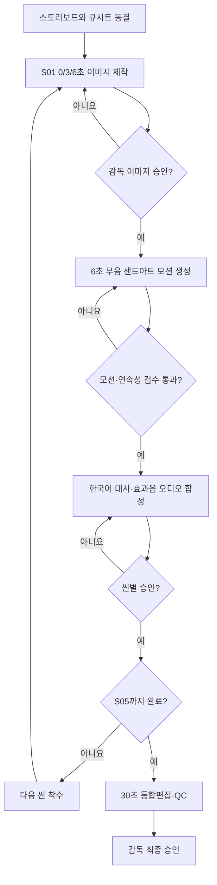

# 샌드아트 제작·QC·인계 절차 V1

## Gate 순서

## 장면별 필수 인계 산출물
- 시나리오/시작·끝·중간 프레임 설명.
- 독립 PNG 3개(0/3/6초)와 필요할 경우 추가 브리지.
- 이미지·ZIP SHA256, 생성법/기존 참조본 출처, 최종 승인 여부.
- 무음 영상 생성 프롬프트, 금지 프롬프트, 타임코드.
- 오디오 큐시트 / 실제 ElevenLabs 음원 길이표.
- 모션 클립 파일명·해시·QC, 감독 `ACCEPTED` 시각/버전.

## 중요 규칙
1. 단계별로 진행하며 S01 승인 전 S02 영상 일괄 생성 금지.
2. 영상 모델에 한국어 대사를 직접 맡기지 않고 **무음 생성 + 정확한 한국어 후반 삽입** 우선.
3. 기존 버전·실사판에서 승인된 이미지 상태는 샌드아트 새 이미지의 승인으로 승계하지 않는다.
4. S01은 현재 3프레임 프리비즈 생성됨. **실물 페이지폰과 하드웨어 형상 대조 및 원본 해상도/모션 QC 미완료**.
5. 최종 MP4 규격 1920×1080 / 30fps / 30.000초 / 900프레임, <500MB. 실제 현장/CI/기밀정보 관련 사항 반드시 공개 적합성 심사.
6. GitHub 작업은 `projects/pagephone-sandart/` 외의 파일을 수정하지 않는다. 바이너리는 별도 인계 상태로 기록하며 공개 저장소 업로드는 별도 승인/적합성 검토 후에만.
